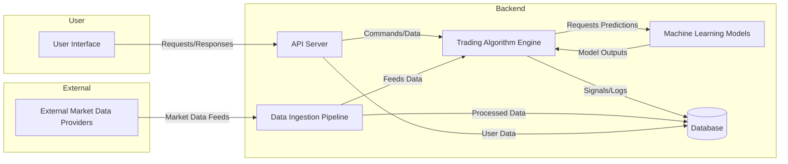
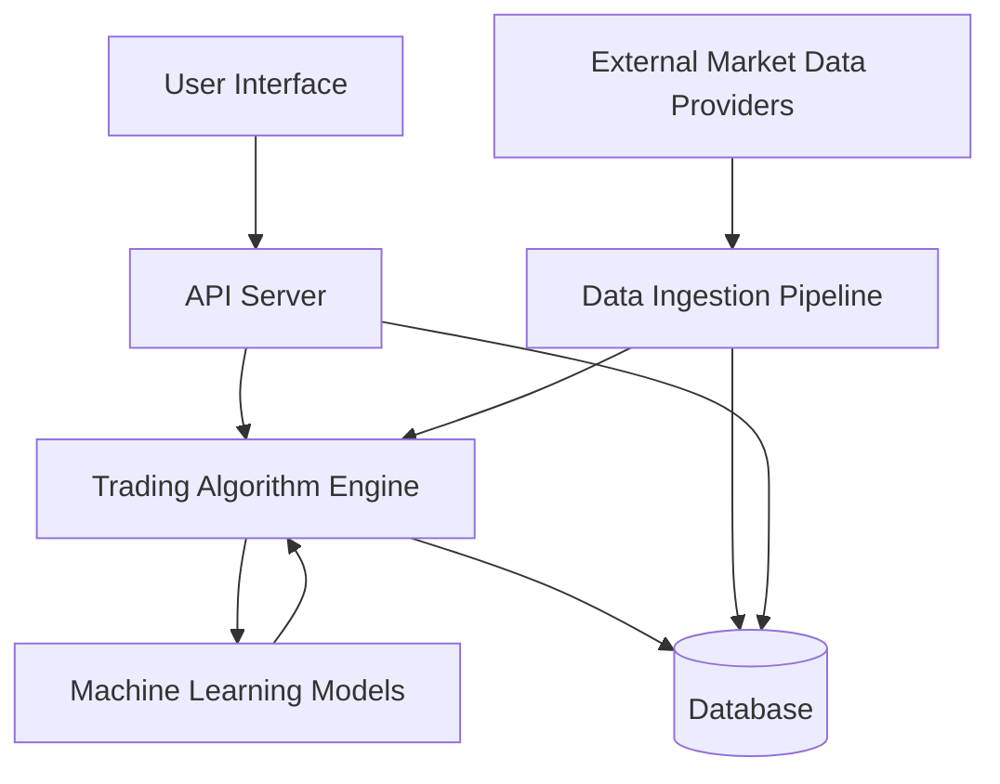
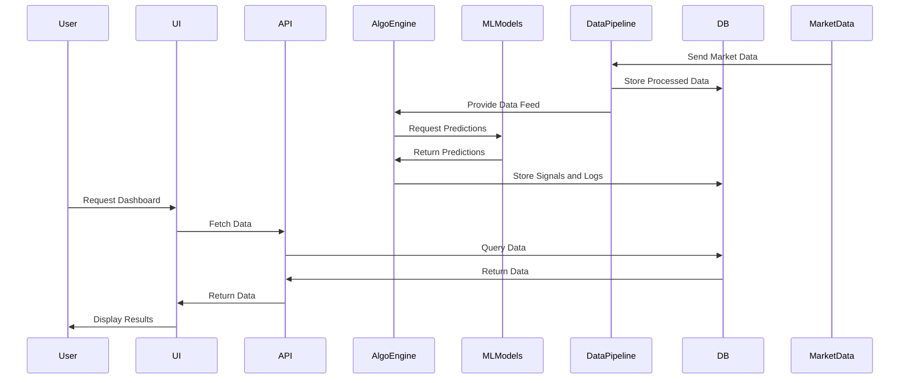
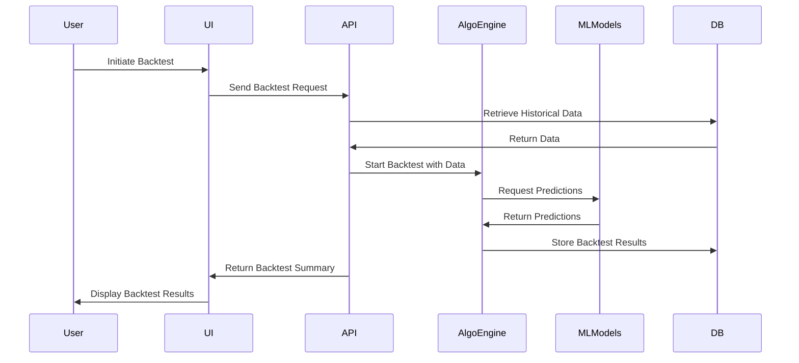
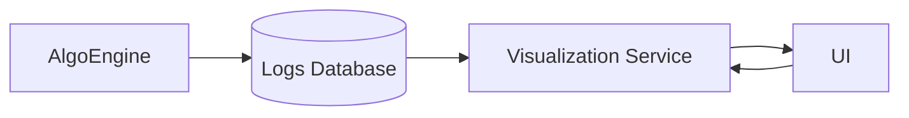
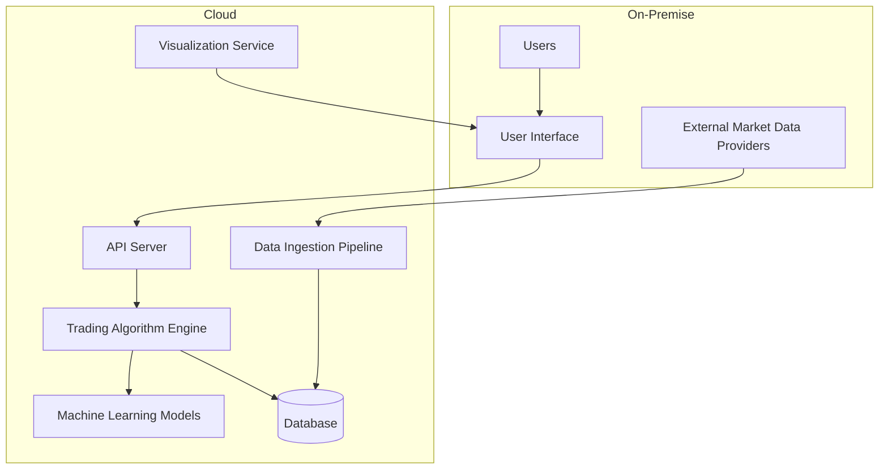
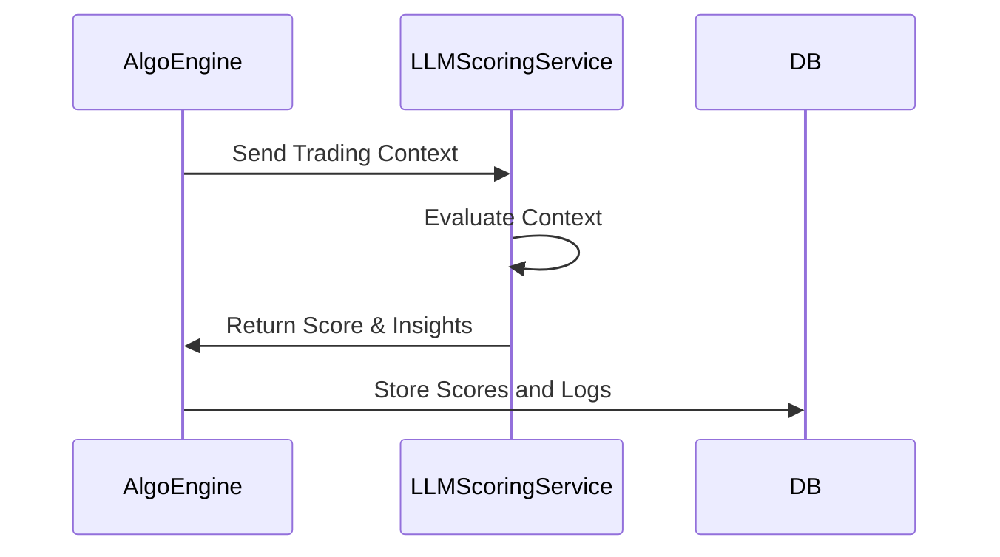

# Architecture Overview

This document provides an overview of the architecture of the Algo Bot Pro LLM Visualization system. It describes the key components, their interactions, and the data flow within the system.

## Components

### 1. User Interface (UI)
- Provides visualization and interaction capabilities for users.
- Displays trading signals, model outputs, and performance metrics.
- Allows users to configure and control the algorithmic trading strategies.

### 2. API Server
- Serves as the backend for the UI.
- Handles user requests and communicates with other backend services.
- Manages authentication, authorization, and session management.

### 3. Trading Algorithm Engine
- Core component that runs algorithmic trading strategies.
- Processes market data and generates trading signals.
- Integrates with machine learning models to improve decision-making.

### 4. Machine Learning Models
- Provides predictions and insights to enhance trading strategies.
- Trained on historical market data.
- Continuously updated with new data and feedback.

### 5. Data Ingestion Pipeline
- Collects real-time and historical market data.
- Cleans and preprocesses data for use by the trading engine and ML models.

### 6. Database
- Stores historical data, trading logs, user information, and model parameters.
- Supports efficient querying and data retrieval.

### 7. External Market Data Providers
- Sources of market data (e.g., stock prices, order books).
- Provide APIs or data feeds for real-time and historical data.

## Architecture Diagram

## Data Flow

1. **Market Data Ingestion**: External market data providers send real-time and historical data to the Data Ingestion Pipeline.
2. **Data Processing**: The pipeline cleans, preprocesses, and stores the data in the database.
3. **Algorithm Execution**: The Trading Algorithm Engine fetches processed data and model predictions to generate trading signals.
4. **Model Predictions**: Machine Learning Models analyze market data and provide predictions to the trading engine.
5. **User Interaction**: Users interact with the system via the UI, which communicates with the API server.
6. **Data Storage**: All relevant data including logs, user info, and model parameters are stored in the database.

## Summary

The system is designed to be modular, scalable, and extensible. Each component focuses on a specific responsibility, allowing easy maintenance and upgrades. The integration of machine learning models with algorithmic trading strategies aims to improve trading performance and adapt to changing market conditions.

---

## Component Overview

## Sequence: Daily Run Cycle

## Sequence: Backtesting Workflow

## Data Flow for Logs & Visuals

## Deployment Overview

## LLM Scoring Seam

